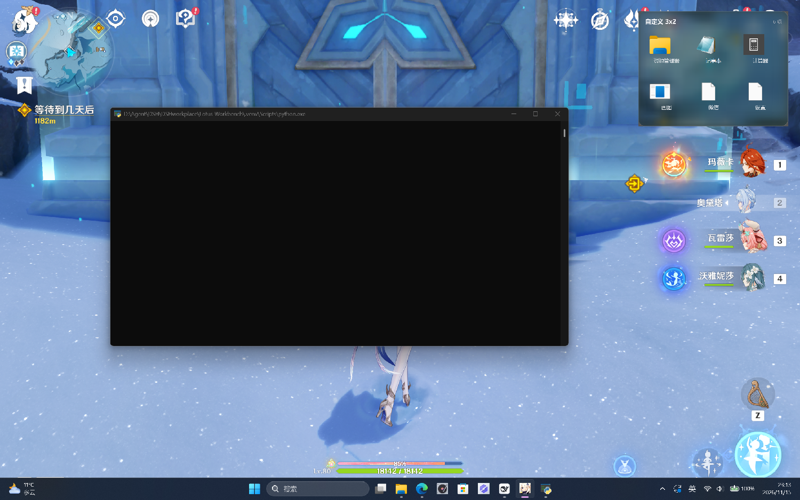

# Lotus Workbench

A keyboard-first Windows workbench that sits **on top of** your desktop instead of replacing it: docked bubble boxes for shortcuts, an edge sidebar for notes / paths / terminals, and a quick-note window.



> Status: v0.5.0 — early but usable. Windows 11 only, Python 3.12+.

## Features

- **Bloom** — desktop bubble boxes docked to the left/right edge, auto-arranged; add files by drag & drop, rename, resize (presets or custom columns × rows), create / delete.
- **Petal** — right-edge hot-zone sidebar with recent notes, common paths (list or icon grid), terminal launchers, and big Settings / Hide-desktop buttons.
- **Ink** — `Alt+N` quick notes with autosave and a note manager.
- **Settings** — Win11-style window: appearance, desktop, sidebar, hotkeys (recorded and hot-reloaded), search index, about.
- **Desktop icons** — toggle native desktop icons from the tray, the sidebar, or `Ctrl+Alt+I`.
- **Local only** — everything lives in `%USERPROFILE%\.lotus`; no network calls.

## Install

```powershell
git clone https://github.com/Ding-Sun/lotus-workbench.git
cd lotus-workbench
python -m venv .venv
.venv\Scripts\pip install -r requirements.txt
.venv\Scripts\python -m app
```

Or double-click `run.bat` / `run-silent.vbs`.

## Build

```powershell
.venv\Scripts\pip install -r requirements-dev.txt
.venv\Scripts\pyinstaller --noconfirm Lotus.spec
```

Output: `dist/Lotus/Lotus.exe` (onedir, windowed).

## Hotkeys

| Key | Action |
| --- | --- |
| `Ctrl+Alt+B` | show / hide bubbles |
| `Ctrl+Alt+Space` | sidebar |
| `Alt+N` | new note |
| `Ctrl+Alt+I` | toggle desktop icons |

All editable in Settings → Hotkeys.

## Limitations

- Frosted backdrop is captured when a window opens; changing the wallpaper requires a restart.
- Theme / accent changes apply after a restart.
- Hover-expand delay is stored but the animation is not wired yet.
- Seek (Everything) and Leaf (document index) are planned.

## License

[MIT](LICENSE) © 2026 Lotus Workbench contributors
