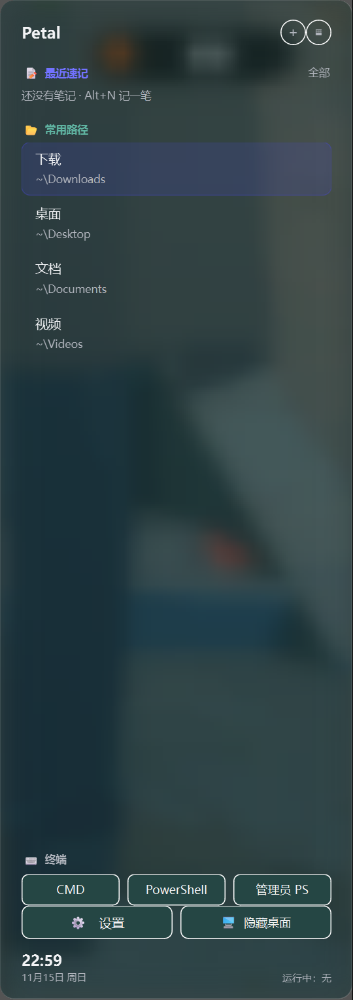
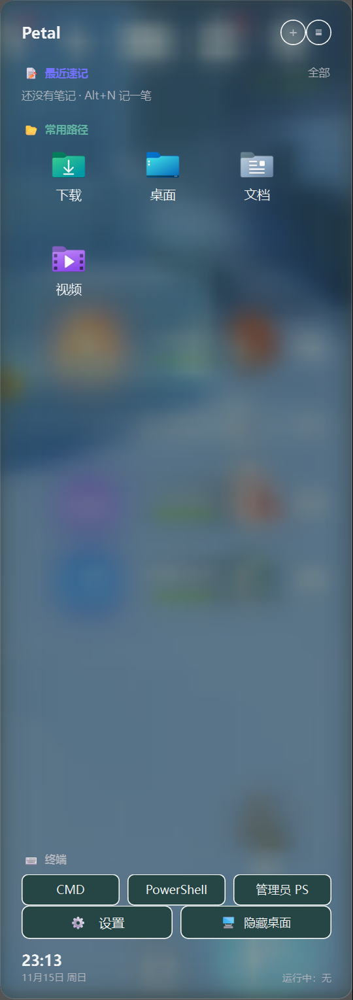
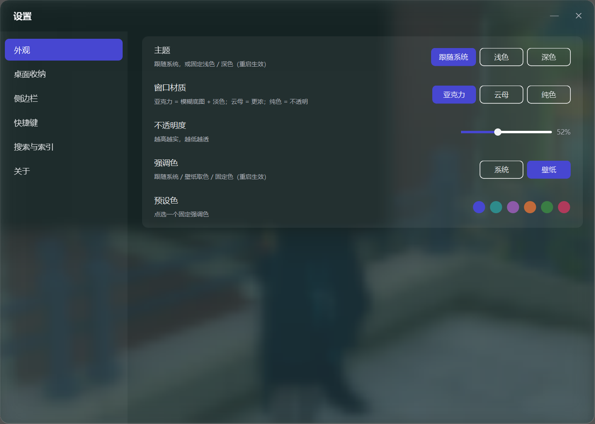

# Lotus Workbench

**Lotus Workbench** 是一个键盘优先的 Windows 桌面工作台。它不替换原生桌面，而是在桌面上叠一层自己的收纳盒、侧边栏和速记入口——图标保留，壁纸保留。

[](LICENSE)
[](https://www.python.org/)
[](https://www.microsoft.com/windows)
[](CHANGELOG.md)


## 这是什么

Windows 桌面上图标一多就乱，快捷方式、文件夹、文档混在一起，想找一个东西要先眯眼扫一遍。

Lotus 的做法是：**把桌面图标收进若干个「收纳盒」**，固定在屏幕一侧，按顺序自动排列；需要找文件时，右侧滑出侧边栏，笔记、常用路径、终端都在那儿。整个程序常驻托盘，不占任务栏。

- 原生桌面保留，不接管 Progman / 壁纸 / 图标
- 收纳盒贴在桌面层，普通窗口会盖住它，`Win+D` 后自动回来
- 纯本地：配置和笔记都在 `%USERPROFILE%\.lotus`，不联网

## 功能

### 收纳盒 Bloom

- 一个收纳盒 = 一个分组，右键任意位置可：添加文件、重命名、调整大小（2/3/4 列或自定义列 × 行）、新建、删除
- 文件可以直接**拖进**收纳盒，自动生成图标项
- 停靠左/右、自动纵向排列；侧边栏滑出时整体让位
- 磨砂玻璃卡片：截取窗口背后的画面做模糊，再叠材质色

### 侧边栏 Petal

- 右上角热区触发（位置和高度可调），滑出/收起带动画
- 最近速记、常用路径、终端入口，三个模块可单独开关
- 常用路径支持**列表**和**图标网格**两种显示方式
- 底部两个大按钮：**⚙ 设置**、**🖥 隐藏桌面**
- 文件可直接拖进侧边栏，加入常用路径




### 速记 Ink

`Alt+N` 随手记一笔，自动保存；笔记管理里可以搜索、重命名、删除。

### 设置窗口

Win11 风格：左侧导航、右侧内容，六个页面。标题栏可拖动，最小化/关闭都是「隐藏窗口」，进程继续留在托盘。



页面：外观（主题 / 材质 / 不透明度 / 强调色）、桌面收纳（停靠、桌面图标、悬停延迟、每盒图标数）、侧边栏（热区、显示方式、模块开关）、快捷键（录制即生效）、搜索与索引（es.exe、扫描根目录）、关于。

### 桌面图标

托盘右键、侧边栏「隐藏桌面」、或 `Ctrl+Alt+I` 切换系统桌面图标。退出 Lotus 时自动恢复。

## 快速开始

### 环境

- Windows 11（Windows 10 未测试）
- Python 3.12+（开发使用 3.14）
- 依赖：PySide6 6.12

```powershell
git clone https://github.com/Ding-Sun/lotus-workbench.git
cd lotus-workbench
python -m venv .venv
.venv\Scripts\pip install -r requirements.txt
.venv\Scripts\python -m app
```

日常启动双击 `run.bat`（有控制台，方便看日志），或 `run-silent.vbs`（无控制台）。

### 打包

```powershell
.venv\Scripts\pip install -r requirements-dev.txt
.venv\Scripts\pyinstaller --noconfirm Lotus.spec
```

产物：`dist/Lotus/Lotus.exe`（onedir，带图标，无控制台）。

## 快捷键

| 快捷键 | 功能 |
| --- | --- |
| `Ctrl+Alt+B` | 显示 / 隐藏收纳盒 |
| `Ctrl+Alt+Space` | 呼出侧边栏 |
| `Alt+N` | 新建速记 |
| `Ctrl+Alt+I` | 隐藏 / 显示桌面图标 |

全部可在 设置 → 快捷键 里录制修改，保存后热重载；被其他程序占用时会提示。

## 配置

`%USERPROFILE%\.lotus\config.json`，首次运行自动生成。常用项：

| 键 | 说明 | 默认 |
| --- | --- | --- |
| `bloom.dock` | 收纳盒停靠方向 `left` / `right` | `right` |
| `bloom.max_items_per_bubble` | 每个盒子最多显示的图标数 | `16` |
| `bloom.hover_delay_ms` | 悬停展开延迟 | `250` |
| `petal.mode` | 常用路径显示 `list` / `grid` | `list` |
| `petal.hot_zone_top` / `hot_zone_height` | 右上角热区位置与高度 | `90` / `140` |
| `theme.surface_mode` | 窗口材质 `acrylic` / `mica` / `solid` | `acrylic` |
| `theme.tint_opacity` | 材质不透明度 20–100 | `52` |
| `theme.accent` | 强调色 `system` / `wallpaper` / `#RRGGBB` | `wallpaper` |
| `seek.es_path` | Everything `es.exe` 路径 | 空（自动发现） |

笔记、日志、崩溃记录也在 `%USERPROFILE%\.lotus`。

## 技术实现

- **PySide6 + Win32**：`RegisterHotKey` 全局热键、DWM 圆角、`SHELLDLL_DefView` 图标显隐
- **桌面层**：每个收纳盒是一个独立窗口，锚定在 Progman 上方的 z-order 槽位；900ms 看门狗在 `Win+D` 后恢复
- **磨砂背景**：Windows 的 `SetWindowCompositionAttribute` / `DWMWA_SYSTEMBACKDROP_TYPE` 对 Qt 窗口不生效，因此改为截屏 → 高斯模糊 → 叠材质色自绘
- **不做的事**：不接管桌面、不替换资源管理器、不轮询文件系统

更细的设计记录见 [docs/ARCHITECTURE.md](docs/ARCHITECTURE.md)。

## 已知限制

- 收纳盒的模糊底图在启动时截取，换壁纸后要重启才更新
- 窗口打开状态下移动，底图不跟随（快照方案的取舍）
- 主题与强调色重启后生效；材质、停靠、热区、快捷键即时生效
- 悬停展开延迟已存进配置，展开动画尚未实现
- `Seek`（全局搜索）和 `Leaf`（文档索引）还在计划中

## 路线图

- [x] M1 窗口骨架与材质
- [x] M2 Petal 侧边栏
- [x] M3 Ink 速记
- [x] M4 收纳盒（停靠、拖拽、右键菜单、自定义大小）
- [x] M5 设置中心
- [ ] M6 Seek：Everything 全局搜索
- [ ] M7 Leaf：文档索引（docx / pdf）
- [ ] 开机自启、主题热切换

## 贡献

欢迎 issue 和 PR，先读 [CONTRIBUTING.md](CONTRIBUTING.md)。提交前请确保：

```powershell
.venv\Scripts\python tools\check_encoding.py
.venv\Scripts\python -m compileall app
```

## 致谢

- 视觉参考：[Untamed Music Player](https://github.com/Huawei-Base/WindowsMusicPlayer-TheUntamedMusicPlayer) 的材质与动画参数（只取设计数值，未复制代码）
- 桌面盒子思路：[DeskBox](https://github.com/Ink-dark/DeskBox)
- 搜索：[Everything](https://www.voidtools.com/) 的 `es.exe`

## 许可证

[MIT](LICENSE) © 2026 Lotus Workbench contributors

---

<sub>English: a keyboard-first Windows workbench with docked desktop bubbles, an edge sidebar, quick notes and a real settings window. See [README.en.md](README.en.md).</sub>
