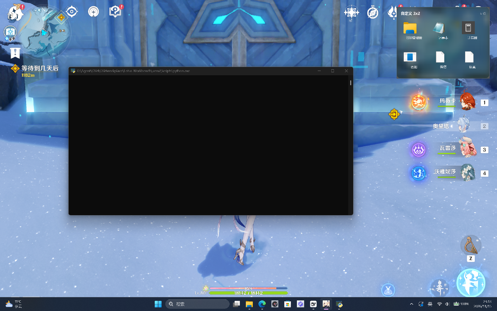

# Lotus Workbench v0.5.0

第一个公开版本。Windows 11 上的桌面工作台：收纳盒贴在桌面上、侧边栏从右边缘滑出、`Alt+N` 随手记。

不替换原生桌面——壁纸、图标、资源管理器都还是系统那一套，Lotus 只是在上面加了一层。



## 这个版本能做什么

**收纳盒 Bloom**
- 多个收纳盒固定停靠屏幕一侧，自动纵向排列
- 右键任意位置：添加文件、重命名、调整大小（2/3/4 列，或自定义列 × 行，最大 4×6）、新建、删除
- 文件可以直接拖进盒子；侧边栏滑出时整体避让
- 磨砂玻璃卡片，材质与不透明度可调

**侧边栏 Petal**
- 右上角热区触发，位置和高度可调
- 最近速记、常用路径、终端入口，三个模块可独立开关
- 常用路径支持列表 / 图标网格两种显示
- 底部「⚙ 设置」「🖥 隐藏桌面」大按钮

**速记 Ink** · `Alt+N` 新建，自动保存，笔记管理可搜索 / 重命名 / 删除。

**设置中心** · 外观、桌面收纳、侧边栏、快捷键（录制即生效）、搜索与索引、关于。

**其它**
- 一键隐藏 / 恢复系统桌面图标（托盘、侧边栏、`Ctrl+Alt+I`）
- 壁纸主色自动作为强调色
- 全部数据留在 `%USERPROFILE%\.lotus`，不联网

## 下载

| 文件 | 说明 |
| --- | --- |
| `Lotus-Workbench-v0.5.0-win64.zip` | 免安装包，解压后运行 `Lotus.exe` |
| `Source code (zip)` | 源码，自行安装依赖运行 |

```powershell
# 免安装包
# 1. 解压到任意目录（建议不要放在 C:\Program Files）
# 2. 双击 Lotus.exe
# 3. 首次运行会在 %USERPROFILE%\.lotus 生成配置与日志
```

从源码运行：

```powershell
python -m venv .venv
.venv\Scripts\pip install -r requirements.txt
.venv\Scripts\python -m app
```

## 系统要求

- Windows 11（24H2 及以上验证过；Windows 10 未测试）
- x64
- 不需要管理员权限

## 快捷键

| 快捷键 | 功能 |
| --- | --- |
| `Ctrl+Alt+B` | 显示 / 隐藏收纳盒 |
| `Ctrl+Alt+Space` | 呼出侧边栏 |
| `Alt+N` | 新建速记 |
| `Ctrl+Alt+I` | 隐藏 / 显示桌面图标 |

## 已知问题

- 收纳盒的磨砂底图在启动时截取，换壁纸后需重启才更新
- 窗口打开时移动，模糊底图不跟随（快照方案的取舍）
- 主题与强调色需重启生效；材质、停靠、热区、快捷键即时生效
- 「悬停展开延迟」已存进配置，展开动画尚未接入
- Seek（Everything 搜索）与 Leaf（文档索引）尚未实现

## 校验

```
SHA256  19BA12D6E32CAA8E82C846EBCE419D81D75666B5A8D30D06AC70427C41F8B7E3
```

## 反馈

- Bug / 功能建议：[Issues](https://github.com/Ding-Sun/lotus-workbench/issues)
- 使用问题：[Discussions](https://github.com/Ding-Sun/lotus-workbench/discussions)
- 完整改动见 [CHANGELOG](https://github.com/Ding-Sun/lotus-workbench/blob/main/CHANGELOG.md)

**License:** MIT
